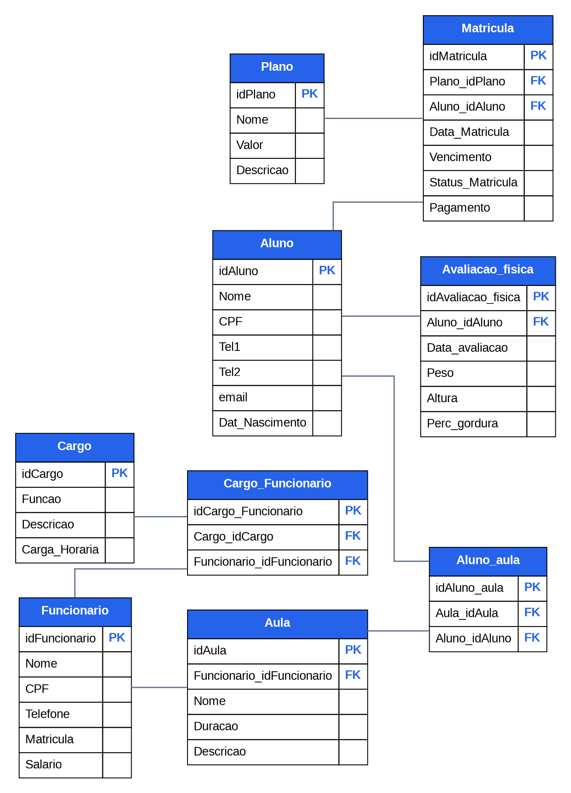
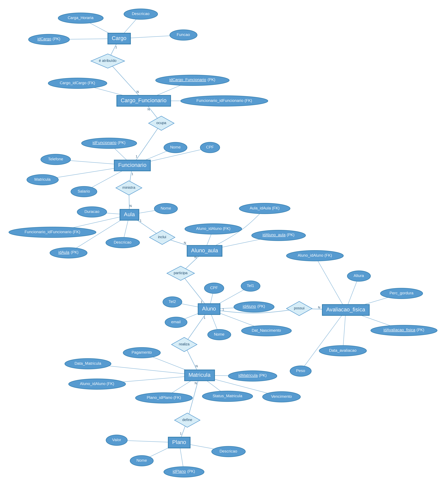

# Gym Database

Projeto acadêmico de modelagem e desenvolvimento de um banco de dados para gerenciamento de uma academia, utilizando Microsoft Access.

## Sobre o projeto

Este projeto consiste na modelagem e implementação de um banco de dados para uma academia, aplicando conceitos de modelagem de dados e organização de informações.

O desenvolvimento contempla a elaboração dos modelos conceituais e a implementação do banco de dados, buscando estruturar e relacionar as informações de maneira organizada.

## Tecnologias e ferramentas

- **Microsoft Access:** criação e implementação do banco de dados.
- **Microsoft Visio:** elaboração do Diagrama Entidade-Relacionamento (DER).
- **XML:** representação do Modelo Entidade-Relacionamento (MER).

## Modelagem do banco de dados

### Modelo Entidade-Relacionamento (MER)

Representação do modelo conceitual do banco de dados.



### Diagrama Entidade-Relacionamento (DER)

Representação gráfica das entidades, atributos e relacionamentos do banco de dados.



## Estrutura do repositório

```text
gym-database/
│
├── imagens/
│   ├── der/
│   │   └── diagrama-entidade-relacionamento.png
│   │
│   └── mer/
│       └── modelo-entidade-relacionamento.png
│
├── ACADEMIA.accdb
├── README.md
├── der_academia.vsdx
└── mer_academia.xml
```

## Objetivos do projeto

- Aplicar conceitos de modelagem de bancos de dados.
- Compreender a organização e o relacionamento entre entidades.
- Desenvolver modelos conceituais de dados.
- Implementar uma estrutura de banco de dados utilizando Microsoft Access.

## Status do projeto

**Concluído.**

## Autor

**devvalvess**

Projeto desenvolvido com fins acadêmicos, como parte do aprendizado em modelagem e desenvolvimento de bancos de dados.
